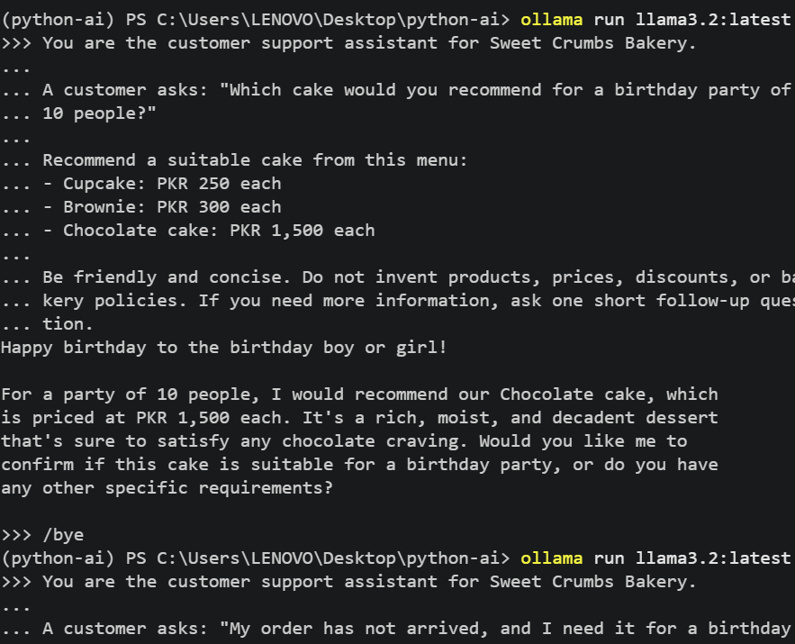

# Python AI Learning Project

A beginner-friendly repository for learning Python fundamentals, writing effective AI prompts, and building practical AI-powered projects.

## Table of Contents

- [Project Structure](#project-structure)
- [Setup](#setup)
- [Module 1 Project: AI Prompt Kit](#module-1-project-ai-prompt-kit)
- [Module 1 Checkpoint 2: AI Front Desk](#module-1-checkpoint-2-ai-front-desk)
- [Module 1 Final Project: Business Helper Bot](#module-1-final-project-business-helper-bot)
- [Learning Goals](#learning-goals)

## Project Structure

```text
python-ai/
├── code/
│   ├── lesson_01_intro.py
│   ├── lesson_04_print_input.py
│   ├── lesson_05_variables.py
│   ├── lesson_06_prompt-cleaner.py
│   ├── lesson_07_conditions.py
│   ├── lesson_08_mini_chatbot.py
│   ├── prompt_kit.py
│   └── project_m1_front_desk.py
├── docs/
│   ├── Lesson_02_Python.md
│   ├── image.png
│   ├── Project-m1-prompt.png
│   ├── project-m1-results.md
│   ├── project-m1-part2-design.md
│   ├── project-m1-part2-results.md
│   ├── project-m1-run.png
│   └── project-m1-part2-run.png
├── src/
│   └── python_ai/
├── .gitignore
├── .python-version
├── pyproject.toml
├── uv.lock
└── README.md
```

*Note: This structure lists the expected project files. Update it if your actual folders or filenames differ.*

## Setup

This project uses Python 3.13 and [uv](https://docs.astral.sh/uv/) for Python project and dependency management.

### Prerequisites

- Python 3.13
- [uv installed](https://docs.astral.sh/uv/getting-started/installation/)
- Ollama installed for local AI prompt testing

### Install dependencies

From the project root directory, run:

```powershell
uv sync
```

### Run the starter program

```powershell
uv run python
```

To run an individual lesson, use its filename. For example:

```powershell
uv run code/lesson_01_intro.py
```

## Module 1 Project: AI Prompt Kit

The **AI Prompt Kit** is a Python command-line tool that collects basic information about a local business and generates three ready-to-use AI prompts.

### What it does

1. **Marketing:** Generates a prompt for a social media post.
2. **Customer service:** Generates a prompt for replying politely to an unhappy customer whose delivery was late, including an apology and a suggested small discount.
3. **Business growth:** Generates a prompt requesting three low-cost AI tools or ideas suited to the business, its customers, location, and monthly budget in PKR.

### Technologies

- Python 3.13
- `input()` and `print()`
- Variables, comments, and f-strings
- Integer conversion with `int()`
- Ollama for testing generated prompts

### How to run

```powershell
uv run code/project_m1_prompt_kit.py
```

Enter the business name, business type, city, main customers, and monthly budget when prompted.

### Demo


### Prompt testing and results

The generated prompts can be tested using Ollama. The model's actual responses, usefulness, and any unsupported claims are documented in the results file.

[View AI Prompt Kit results](docs/project-m1-results.md)

### Who would benefit?

Small business owners who want to use AI for marketing, customer service, and business growth but need help writing effective prompts.

## Module 1 Checkpoint 2: AI Front Desk

The **AI Front Desk** is a beginner-friendly Python command-line assistant designed for a fictional bakery called Sweet Crumbs Bakery. It handles common customer questions using rules, calculates order quotes, and prepares prompts for questions that need AI support.

### Features

- Greets customers and asks for their name.
- Answers frequently asked questions about opening hours, location, delivery, and menu items.
- Routes complaints to human support.
- Calculates order subtotals, bulk discounts, delivery fees, and totals.
- Handles unknown menu items and invalid quantities without crashing.
- Prepares AI prompts for questions that do not match the FAQ rules.
- Selects a local-model option for questions that may contain private information.
- Estimates cloud AI costs for other fallback questions.
- Prints a session report with message counts, complaints, completed quotes, total quoted value, and estimated AI cost.

### Business rules

| Rule | Value |
|---|---:|
| Cupcake | PKR 250 each |
| Brownie | PKR 300 each |
| Chocolate cake | PKR 1,500 each |
| Bulk discount | 10% for quantities of 10 or more |
| Delivery fee | PKR 200 |
| Free delivery threshold | PKR 3,000 after discount |
| Local-model estimated cost | PKR 0 |

*These are illustrative values for the assignment, not verified prices or policies for a real bakery.*

### How to run

From the project root directory:

```powershell
uv run code/project_m1_front_desk.py
```

Enter your name, then ask a question or type `/quote` to calculate an order. Type `bye` to end the session and display the report.

### Design and testing

- [View intent design and business rules](docs/project-m1-part2-design.md)
- [View rule-based tests and Ollama prompt evaluations](docs/project-m1-part2-results.md)

The project includes manual Ollama tests for a birthday cake recommendation and a late-order complaint. These tests evaluate helpfulness, accuracy, and unsupported claims.

### Demo screenshot



### Business value

The front desk can reduce repetitive questions and calculate quotes consistently, helping staff spend more time on customer-specific issues. A business may pay for a solution like this to reduce manual work and improve response times.

### Current limitations

The Python program currently prepares AI prompts and estimates costs; it does not automatically send fallback prompts to Ollama or a cloud model. The local-model selection and cost estimate are demonstrations of routing logic, not proof that private data has been processed by a local model.

## Module 1 Final Project: Business Helper Bot

This section documents an example intent design for a fictional business, City Care Clinic. It illustrates how keyword-based rules can answer common questions and route complaints or requests for human support.

### Intent design table — City Care Clinic

| Intent | Keywords | Example reply |
|---|---|---|
| Greeting | `hi`, `hello`, `hey` | Hello! How can I help you today? |
| Timings | `timing`, `hours`, `open`, `close` | We are open 10 AM to 8 PM, Monday to Saturday. |
| Consultation fee | `fee`, `fees`, `price`, `cost` | Consultation fee is PKR 2,000. |
| Location | `location`, `address`, `where` | We are at Main Boulevard, Lahore. |
| Appointment | `appointment`, `book`, `booking` | Please call the clinic to arrange an appointment. |
| Complaint | `complaint`, `late`, `problem`, `wrong` | Sorry about that. The clinic manager will call you today. |
| Human support | `agent`, `human` | Connecting you to a human... |

*Note: Clinic details, fees, address, hours, and the complaint-handling promise are illustrative. Confirm all information with the actual business before using it with customers.*

## Learning Goals

- Practise Python fundamentals through practical projects.
- Learn variables, strings, conditions, input, and output.
- Write clear, structured prompts for AI models.
- Evaluate AI responses for usefulness and accuracy.
- Identify unsupported claims and improve prompts.
- Build a portfolio of beginner-friendly Python and AI projects.

## Future Improvements

- Connect the front desk's AI fallback to Ollama.
- Add stronger privacy detection and verified human-contact details.
- Add automated tests for FAQ matching and quote calculations.
- Replace illustrative business information with verified details when adapting the project for a real business.


